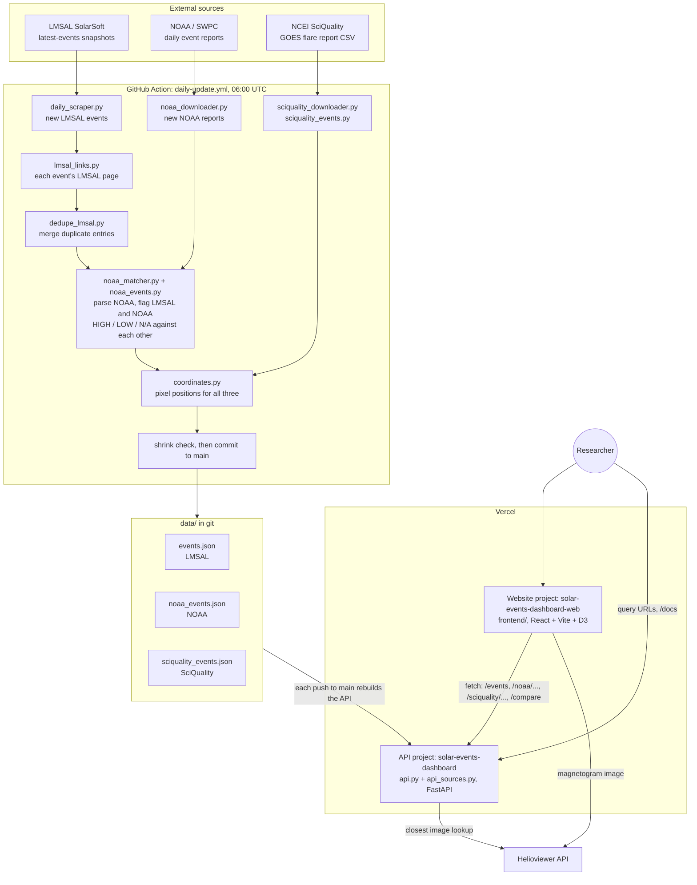

# Solar Events Dashboard
 
A full-stack web application for exploring, comparing and downloading solar flare records from three
catalogues: **LMSAL** (Lockheed Martin Solar and Astrophysics Laboratory, SolarSoft latest events),
**NOAA/SWPC** (daily X-ray event reports) and **NCEI SciQuality** (the science-quality GOES XRS flare
report). LMSAL and NOAA flares are cross-checked against each other (HIGH / LOW / N/A), duplicate
LMSAL entries are merged, every flare links back to its source record, and a Compare page charts the
three catalogues side by side. A daily GitHub Action keeps the data current and Vercel serves the API
and the website.

- Website: https://solar-events-dashboard-web.vercel.app
- API: https://solar-events-dashboard-tau.vercel.app (interactive docs at `/docs`)
 
---

## Architecture



How the pieces fit:

1. **Collect** (daily, GitHub Action). The scraper adds new LMSAL events and records each one's own
   LMSAL page; duplicate LMSAL entries (same class, peak and position) are merged; new NOAA reports
   and the newest SciQuality report are downloaded.
2. **Process.** NOAA reports are parsed into one record per X-ray flare; LMSAL and NOAA are flagged
   against each other (a merged flare is compared using every start time it was listed with);
   positions are converted to pixel coordinates on a 512 px solar image.
3. **Store.** Everything lands in three JSON files under `data/`, committed to `main`. The workflow
   refuses to commit if any file loses entries.
4. **Serve.** Vercel rebuilds the API on every push to `main`. `api_sources.py` gives the three
   catalogues one shared interface: cached loading, validated filters (a bad value is a 400 with a
   message), per-source lists, downloads, single records, stats, and `/compare` chart data.
5. **Show.** The website calls the API, shows each catalogue in its own tab, draws the Compare chart
   with D3, and links each flare to its source record. Solar images come from Helioviewer; the
   "closest image" lookup goes through the API because Helioviewer only allows it from localhost
   in a browser.

---
 
## Project Structure
 
```
solar-events-dashboard/
├── api.py                      # FastAPI app: routes for the three catalogues, /compare, /solar-image/closest
├── api_sources.py              # Shared Source class: loading + cache, filters + validation, stats, compare()
├── pyproject.toml              # Python project + Vercel entrypoint (api:app)
├── requirements.txt            # Python dependencies
├── .vercelignore               # What the API upload leaves out (venv, tests, raw NOAA files, analysis/, ...)
├── procfile, railway.json      # Old Railway deployment (no longer used)
├── README.md
├── NOTES.md                    # Working notes: findings and open questions
│
├── pipeline/                   # Builds and updates the dataset (order: see Automated Daily Updates)
│   ├── scraper.py              # Full scrape of every LMSAL event since 2002-09-26
│   ├── daily_scraper.py        # Resumes from the newest event in events.json (run daily)
│   ├── lmsal_links.py          # Records each LMSAL event's own page link (provenance); backfills missing ones
│   ├── dedupe_lmsal.py         # Merges LMSAL entries that are the same flare (kept under merged_from)
│   ├── noaa_downloader.py      # Downloads NOAA event txt files via FTP
│   ├── noaa_events.py          # Parses every NOAA XRA flare (FLA line gives its location)
│   ├── noaa_matcher.py         # Flags LMSAL and NOAA HIGH / LOW / N/A against each other; writes both files
│   ├── sciquality_downloader.py # Fetches the newest NCEI science-quality flare report
│   ├── sciquality_events.py    # Converts that CSV to sciquality_events.json
│   └── coordinates.py          # Converts positions to pixel coordinates for all three catalogues
│
├── data/                       # The dataset (written by pipeline/, read by the API)
│   ├── events.json             # LMSAL flares: flags, matches, links, merged duplicates, pixels
│   ├── noaa_events.json        # NOAA X-ray flares: flags, matches, locations, pixels
│   ├── sciquality_events.json  # NCEI SciQuality flares: fluxes, satellite, locations, pixels
│   ├── goes_sciquality/        # The raw NCEI report CSV + its metadata
│   ├── noaa_data/              # Raw NOAA txt files, one per day (YYYYMMDDevents.txt)
│   └── noaa_unavailable.txt    # Dates NOAA has no report for, so they aren't re-downloaded
│
├── analysis/                   # Research scripts — read data/, never modify it
│   ├── compare_events.py       # Field-by-field LMSAL vs NOAA comparison
│   ├── cross_check.py          # Class disagreements between matched events
│   ├── timing_analysis.py      # Begin-time differences between the catalogues
│   ├── window_optimization.py  # Derives the matching window
│   ├── window_significance.py  # Significance test for each window width
│   ├── flare_match_tolerance_sweep.py  # Match counts as each tolerance loosens
│   └── results/                # CSV outputs of the scripts above
│
├── tests/                      # pytest: parser, matcher, merge, links, SciQuality, API, /compare
│   └── fixtures/               # Small NOAA and SciQuality files in the real formats
│
├── frontend/                   # React + Vite website
│   ├── src/
│   │   ├── App.jsx             # Tabs (LMSAL / NOAA / SciQuality / Compare); state kept in the URL
│   │   ├── SourceDashboard.jsx # One table + filters + downloads + flare popup, configured per source
│   │   ├── sources.js          # Per-source columns, flag sentences, source links, merged-entry notes
│   │   ├── ComparePage.jsx     # Compare search, totals, caption, SVG/CSV download
│   │   ├── CompareChart.jsx    # D3 chart: counts per day/month/year, or each flare by peak flux
│   │   ├── chartStyle.js       # Fixed color + dash + marker per catalogue
│   │   ├── compareData.js      # Coverage gaps and CSV export shared by chart and download
│   │   ├── solarImage.js       # Helioviewer image lookup and screenshot URL
│   │   ├── api.js              # API address (VITE_API_BASE) and fetch helper
│   │   └── urlState.js         # Reads/writes the tab and filters in the address bar
│   └── tests/                  # node --test: chart data, source links, flag sentences, images
│
└── .github/workflows/
    └── daily-update.yml        # Runs pipeline/ daily and commits the new data to main
```

Every script finds its files relative to its own location, so it can be run from any folder:
`python pipeline/daily_scraper.py` from the repo root and
`python ~/path/to/repo/pipeline/daily_scraper.py` from anywhere else do the same thing.
 
---
 
## Installation
 
### Python Dependencies
 
```bash
pip install -r requirements.txt
```
 
Or manually:
 
```bash
pip install httpx beautifulsoup4 fastapi uvicorn python-multipart
```
 
### Node.js Dependencies
 
```bash
cd frontend
npm install
```
 
---
 
## How to Run
 
**Terminal 1 — Start the FastAPI backend:**
```bash
cd path/to/solar-events-dashboard
/opt/miniconda3/bin/python -m uvicorn api:app --reload
```
 
**Terminal 2 — Start the React frontend:**
```bash
cd path/to/solar-events-dashboard/frontend
npm run dev
```
 
- Backend runs at: `http://localhost:8000`
- Frontend runs at: `http://localhost:5173` (it calls `http://localhost:8000` unless `VITE_API_BASE` is set)

**Tests:**
```bash
python -m pytest tests -q        # pipeline, matcher, merge, API (from the repo root)
cd frontend && npm test          # website helpers (node's built-in test runner)
```

---

## Deployment (Vercel)

Two Vercel projects serve the app:

| Project | What it builds | Address |
|---|---|---|
| `solar-events-dashboard` | The FastAPI app (`api:app`, see `pyproject.toml`), with the files in `data/` | https://solar-events-dashboard-tau.vercel.app |
| `solar-events-dashboard-web` | The website in `frontend/`, built with `VITE_API_BASE` set to the API address | https://solar-events-dashboard-web.vercel.app |

- The API project is connected to GitHub, so every push to `main`, including each daily bot commit,
  rebuilds it with the new data. `.vercelignore` keeps the upload small (no `venv/`, `tests/`,
  `analysis/`, raw NOAA files or the raw SciQuality CSV).
- The website only needs rebuilding when its code changes. To deploy it by hand:
  ```bash
  cd frontend
  vercel deploy --prod --build-env VITE_API_BASE=https://solar-events-dashboard-tau.vercel.app
  ```
- `/scrape` doesn't work on Vercel (its servers can't save files); the daily GitHub Action does that job.
- A failed build never replaces a working deployment, so the site keeps running if a build breaks.
---
 
## Scripts — Run in Order

Run these from the repo root. They live in `pipeline/` and read and write `data/`.
 
### 1. Scrape All Historical LMSAL Events (run once)
```bash
/opt/miniconda3/bin/python pipeline/scraper.py
```
Scrapes all solar flare events from the LMSAL archive starting from the first LMSAL event (2002-09-26) up to today. Merges with existing `data/events.json` without overwriting historical data. Only needs to be run once to build the initial database.
 
### 2. Update with New Events (run daily)
```bash
/opt/miniconda3/bin/python pipeline/daily_scraper.py
```
Resumes from the newest event already in `events.json` and scrapes every LMSAL snapshot from that date forward. Merges new events into the existing `events.json` without touching historical data.

Because the cutoff comes from the data rather than from today's date, a missed run heals itself: if the machine was asleep for six weeks, the next run scrapes all six weeks. No separate backfill step is needed.

All file paths resolve relative to the script's own folder, so it can be run from any working directory (cron runs jobs from `$HOME`).
 
To automate daily updates using macOS crontab:
```bash
# Open crontab editor
crontab -e
 
# Add this line to run at midnight every day
0 0 * * * /opt/miniconda3/bin/python /path/to/solar-events-dashboard/pipeline/daily_scraper.py
```
 
### 3. Download NOAA Data
```bash
/opt/miniconda3/bin/python pipeline/noaa_downloader.py
```
Connects to the NOAA FTP server (`ftp.swpc.noaa.gov`) and downloads event txt files for each unique date present in `events.json`. Files saved to `data/noaa_data/`. Automatically skips dates where NOAA has no data.
 
### 3b. Merge Duplicate LMSAL Entries
```bash
/opt/miniconda3/bin/python pipeline/dedupe_lmsal.py
```
LMSAL builds an event's ID from its start time, so when it lists one flare twice with start times a
few minutes apart (or corrects the start and lists it again), the flare ends up with two IDs. Two
entries are treated as the same flare when they have the **same GOES class, same peak time and same
position**, ignoring the `( AR )` part of the position (one entry often has the region number and the
other doesn't). On the October 2026 data this merges 408 entries into 403 flares (50,444 → 50,036).

- The merged record is LMSAL's latest version of the flare (the entry still on its most recent
  snapshot); if LMSAL kept listing both to the end, the one with the earlier start. If only a dropped
  entry has the AR number, it is copied over.
- Every other entry is kept inside it under `merged_from` (ID, times, position, LMSAL link, snapshot
  history), and the API still finds a flare by any of its old IDs.
- The matcher compares NOAA against **every** start time a merged flare was listed with, so merging
  never takes a match away: every NOAA flag is the same as before merging.
- Once merged, the record that is kept stays the kept one, so re-running doesn't change a flare's ID.
- Entries with the same class and position but a different peak time are left separate; they may be
  two real flares.

### 4. Match & Assign Quality Flags
```bash
/opt/miniconda3/bin/python pipeline/noaa_matcher.py
```
Parses every NOAA `XRA` flare into `data/noaa_events.json` (via `pipeline/noaa_events.py`) and
flags LMSAL events and NOAA flares against each other. Both catalogues get a `quality_flag`:
 
| Flag | Condition |
|------|-----------|
| `HIGH` | The other catalogue has a flare on the same date, same GOES class, begin times within `MATCH_WINDOW_MINUTES` (3) |
| `LOW` | The other catalogue has a flare starting within the window, but of a different class |
| `N/A` | The other catalogue has nothing starting within the window (or this flare has no begin time or class) |
 
The closest same-class flare is recorded as `matched_noaa_id` / `matched_lmsal_id`. NOAA flares
before 2002-09-26 are all `N/A`, since LMSAL's catalogue starts then.
 
Only `XRA` (X-Ray Activity) type NOAA events are used since those are the only ones with GOES
classifications. Every `XRA` line is kept; a field NOAA left blank (`////`) is stored as `null`
and shown as `N/A`. A flare's location comes from the `FLA` (H-alpha) line with the same event
number, when there is one. See **Quality Flag Logic** below for what the flag does and does not measure, and
for how the window was derived.
 
### 5. Download the SciQuality Report
```bash
/opt/miniconda3/bin/python pipeline/sciquality_downloader.py
/opt/miniconda3/bin/python pipeline/sciquality_events.py
```
Fetches the newest NCEI science-quality GOES XRS flare report into `data/goes_sciquality/` (it only
replaces the current file if the new one has the same columns and no fewer flares) and converts it to
`data/sciquality_events.json`. Fluxes are kept as published — unscaled, unlike SWPC/LMSAL before
2019-12-09. SciQuality flares are not flagged against the other catalogues.

### 6. Calculate Pixel Coordinates
```bash
/opt/miniconda3/bin/python pipeline/coordinates.py
```
Converts each flare's position in all three catalogues (e.g. `S11W04`) to pixel coordinates (`pix_x`, `pix_y`) on a 512x512 solar image using heliographic coordinate transformation:
 
```
HGS (lat/lon degrees)
    → HCC (Heliocentric, meters)
    → HPC (Helioprojective, arcseconds)
    → Pixel coordinates (512x512 space)
```
 
---
 
## API Reference
 
Interactive documentation is served at `/docs` on any running instance.
 
### Endpoints
 
| Endpoint | Description |
|----------|-------------|
| `GET /` | Service info and endpoint index |
| `GET /stats` | Dataset summary — totals, date range, quality split, last update time |
| `GET /events` | Filtered event list (paginated) |
| `GET /events/{event_id}` | A single event, e.g. `gev_20260901_0054` |
| `GET /events/download/` | Same filters, returned as a file attachment with no row limit |
| `GET /noaa/events`, `/noaa/events/download`, `/noaa/events/{id}`, `/noaa/stats` | The same for NOAA/SWPC X-ray flares; ids look like `noaa_20240514_3040` |
| `GET /sciquality/events`, `/sciquality/events/download`, `/sciquality/events/{id}`, `/sciquality/stats` | The same for the NCEI science-quality report; ids look like `sq_202405141646` |
| `GET /compare` | Chart data for any of the three sources (see below) |
 
### Query parameters
 
Accepted by every list and download endpoint:
 
| Parameter | Example | Description |
|-----------|---------|-------------|
| `start_date` | `2026-04-01` | Flares starting on or after this date (a time, `2026-04-01 10:30`, also works) |
| `end_date` | `2026-04-30` | Flares starting on or before this date (the whole day) |
| `goes_class` | `M`, `X1`, `C2.5` | A family, a class bin (`X1` = X1.0 to X1.9, not X10+), or a class at the precision given |
| `active_region` | `13664`, `3664`, `AR3664` | NOAA active region (stored as the 4-digit number) |
| `quality_flag` | `HIGH`, `LOW`, `N/A` | LMSAL and NOAA only |
| `limit` | `500` | Rows per page — list endpoints only, default 1000, max 30000 |
| `offset` | `1000` | Row to start from — list endpoints only |
 
A value the API can't use returns `400` with a message saying what it expected, e.g.
`{"detail": "goes_class must look like X, X1 or X1.5, got 'Z9'"}`, rather than an empty list.
A flare whose field is missing never matches a filter on that field; a NOAA flare without a begin
time is still found by date, using its report's date.

`/compare?sources=lmsal,noaa,sciquality` takes the same date, class and region filters. For ranges
of 31 days or less it returns each flare (`mode: "flares"`: peak time, class, flux); for longer
ranges it returns counts per day (up to a year), month (up to 10 years) or year (`mode: "counts"`),
with every bin present. It also returns per-source `totals`, each source's `coverage` start date,
and `notes` for the figure caption.
 
`/events` returns a plain JSON array, ordered newest first — so page 1 is the most recent data.
The total number of matching events, ignoring pagination, is returned in the `X-Total-Count`
response header.
 
### Examples
 
```bash
# every M-class flare in April 2026
curl "$API/events?start_date=2026-04-01&end_date=2026-04-30&goes_class=M"
 
# second page of 500
curl "$API/events?limit=500&offset=500"
 
# how many events match, without downloading them all
curl -sD - -o /dev/null "$API/events?goes_class=X&limit=1" | grep -i x-total-count
 
# the whole filtered set as a file
curl -OJ "$API/events/download/?quality_flag=HIGH"
```
 
```python
import httpx
 
events = httpx.get("$API/events", params={
    "start_date": "2026-01-01",
    "goes_class": "M",
    "limit": 5000,
}).json()
```
 
CORS is open, so the API can be called directly from browser-based tools and notebooks.
 
---
 
## Automated Daily Updates
 
`.github/workflows/daily-update.yml` runs the full pipeline every day at 06:00 UTC and commits
the refreshed data back to the repository. It can also be triggered by hand from the Actions tab.
 
It also fetches the newest SciQuality report and rebuilds `data/noaa_events.json` and
`data/sciquality_events.json`.

The workflow refuses to commit if the flare count of any of the three files drops, since the
pipeline only ever adds flares — a decrease would mean something parsed wrong. A failed NOAA or
SciQuality download does not fail the run: NOAA retries every missing date next time, and SciQuality
keeps yesterday's report.
 
Because each update is a commit, the dataset is versioned: an analysis can be pinned to a specific
day's state of the data and reproduced later.
 
---
 
## Keeping the Database Up To Date
 
```
First time setup:
1. python pipeline/scraper.py          → builds full historical database (2002 to now)
   python pipeline/dedupe_lmsal.py     → merges LMSAL entries that are the same flare
2. python pipeline/noaa_downloader.py  → downloads NOAA comparison files
3. python pipeline/sciquality_downloader.py → downloads the NCEI science-quality report
4. python pipeline/sciquality_events.py    → builds sciquality_events.json
5. python pipeline/noaa_matcher.py     → builds noaa_events.json, flags LMSAL and NOAA
6. python pipeline/coordinates.py      → adds pixel coordinates to all three

Daily maintenance:
1. python pipeline/daily_scraper.py    → adds every event since the newest one on file
   python pipeline/lmsal_links.py && python pipeline/dedupe_lmsal.py
2. python pipeline/noaa_downloader.py  → downloads any new NOAA files
3. python pipeline/sciquality_downloader.py && python pipeline/sciquality_events.py
4. python pipeline/noaa_matcher.py     → updates NOAA flares and quality flags
5. python pipeline/coordinates.py      → updates pixel coordinates
```
 
---
 
## API Endpoints
 
### `GET /events`
Returns filtered list of solar events.
 
**Query Parameters:**
| Parameter | Format | Example |
|-----------|--------|---------|
| `start_date` | YYYY-MM-DD | `2026-02-16` |
| `end_date` | YYYY-MM-DD | `2026-02-19` |
| `goes_class` | Family, bin or class | `C`, `M1`, `X1.5` |
| `active_region` | Region number | `13664` or `AR3664` |
| `quality_flag` | `HIGH`, `LOW`, `N/A` | `N/A` |

The same parameters work on `/noaa/events` and `/sciquality/events` (no `quality_flag` there);
see **API Reference** above.
 
**Examples:**
```
http://localhost:8000/events
http://localhost:8000/events?goes_class=C
http://localhost:8000/events?start_date=2026-02-16&end_date=2026-02-19
http://localhost:8000/events?start_date=2026-02-16&goes_class=M
```
 
### `GET /events/{event_id}`
Returns a single event by ID.
 
```
http://localhost:8000/events/gev_20260216_1224
```
 
### `GET /events/download/`
Same filtering as `/events` but returns a downloadable `events.json` file.
 
```
http://localhost:8000/events/download/?goes_class=C
```
 
### `GET /scrape`
Triggers the daily scraper to run in the background and fetch new events.
 
```
http://localhost:8000/scrape
```
 
---
 
## Frontend Features
 
- **Source tabs** — `LMSAL | NOAA | SciQuality | Compare`; each source has its own table and columns
- **Filters** — date range, GOES class, active region, and quality flag (LMSAL and NOAA); the API's
  error message shows next to the form when a value can't be used
- **Missing values** — shown as `N/A`, so a flare is never hidden because one detail is missing
- **Download CSV / JSON** — the full filtered set for the current source, not just the page on screen
- **Solar image popup** — click a flare ID to see all its details, what its flag means, and the
  magnetogram nearest its time from Helioviewer (SDO/HMI from mid-2010, SOHO/MDI before), with a
  red dot at its position when one is recorded. An image is shown only if one exists within an hour
  of the flare; otherwise the popup says how far away the nearest one is
- **Compare page** — search once and chart the catalogues together: each flare by peak flux for up to
  31 days, or flares per day/month/year for longer ranges. Paper-style figure (each source has a fixed
  color, dash and marker, so it reads in black-and-white too), a caption with the data notes, and
  "Download figure (SVG)" / "Download data (CSV)". "Compare these" on any table opens it with the
  same filters.
- **Shareable URLs** — the tab and filters live in the address bar (e.g.
  `?view=compare&start=2024-05-01&end=2024-05-31`), so Back works and a search can be sent as a link
- **Download from a link** — add `format=csv` or `format=json` to a source tab's link (e.g.
  `?view=noaa&start=2024-05-01&end=2024-05-31&class=M&format=csv`) and the full filtered set downloads as
  soon as the results load, the same file as the download buttons. `format` is then removed from the
  address bar, so a reload doesn't download it again. It downloads nothing, and says why, when no flares
  match, a filter is invalid or the format isn't `csv` or `json`. Browsers that block downloads which
  weren't started by a click may ask first; the buttons always work
- **API address** — set `VITE_API_BASE` when building to point at a deployed API (default
  `http://localhost:8000`)
---
 
## Event Data Fields
 
Each event in `events.json` contains:
 
| Field | Description | Example |
|-------|-------------|---------|
| `event_id` | Unique event identifier | `gev_20260216_1224` |
| `event_start` | Start date and time | `2026/02/16 12:24:00` |
| `event_stop` | Stop time | `13:42:00` |
| `event_peak` | Peak time | `13:07:00` |
| `event_GOES` | GOES classification | `C1.0` |
| `event_position` | Derived heliographic position | `S18E10` |
| `seen_in_dates` | LMSAL snapshot URLs where event appeared | `[...]` |
| `quality_flag` | NOAA comparison result | `HIGH`, `LOW` or `N/A` |
| `matched_noaa_id` | The NOAA flare it matched (HIGH only) | `noaa_20260216_1520` |
| `matched_via` | Which LMSAL entry's start time made the match (its own ID, or a merged duplicate's) | `gev_20260216_1224` |
| `merged_from` | Duplicate LMSAL entries merged into this flare, each with its ID, times, position, link and snapshots (only on merged flares) | `[{"event_id": "gev_20261001_2121", ...}]` |
| `end_time_diff` | LMSAL stop minus NOAA end, in minutes; `null` when unavailable | `0` |
| `pix_x` | X pixel coordinate on 512x512 image | `300.5` |
| `pix_y` | Y pixel coordinate on 512x512 image | `210.3` |
 
`data/noaa_events.json` holds one record per NOAA `XRA` flare: `event_id`, `date`, `begin`, `peak`,
`end` (`YYYY-MM-DD HH:MM:00`), `goes_class`, `observatory`, `active_region`, `location`,
`quality_flag`, `matched_lmsal_id`, `pix_x`, `pix_y`.

`data/sciquality_events.json` holds one record per NCEI flare: `event_id`, `start`, `peak`, `end`,
`goes_class`, `peak_flux` and `background_flux` (W m⁻², as published), `satellite`,
`active_region`, `location` and `location_source` (`XRS`-derived from 2017, else `SWPC`), `pix_x`,
`pix_y`.

Any field the source left blank is `null`.

---
 
## Data Sources
 
| Source | URL | Description |
|--------|-----|-------------|
| LMSAL Archive | `https://www.lmsal.com/solarsoft/latest_events_archive.html` | Solar flare event snapshots |
| NOAA FTP | `ftp://ftp.swpc.noaa.gov/pub/indices/events` | Daily solar event reports |
| NCEI SciQuality | `https://data.ngdc.noaa.gov/platforms/solar-space-observing-satellites/goes/multi/l2/data/xrsf-l2-flrpt_science/csv/` | Science-quality GOES XRS flare report |
| Helioviewer | `https://api.helioviewer.org/v2/` | SDO/HMI and SOHO/MDI magnetograms for the flare popup |
 
---
 
## Quality Flag Logic
 
> ### What the flag actually measures
>
> **`HIGH` should not be read as "two independent sources agree."**
>
> Across matched pairs, begin times are identical to the minute in **99.2%** of cases, the mean
> offset is **−0.0001 minutes**, and end times agree exactly in **93.1%** of cases. Two independent
> detection pipelines — different instruments, different background subtraction, different onset
> criteria — do not produce agreement like that. The overwhelming likelihood is that LMSAL ingests
> NOAA's event list rather than deriving onset times independently.
>
> If so, `HIGH` means *"this LMSAL record was successfully matched back to the NOAA row it derives
> from"*. That is a **provenance and integrity check**, not independent confirmation of a flare. It
> is still a useful thing to measure — it detects transcription errors, dropped records and
> classification drift — but it cannot be cited as cross-instrument validation.
>
> Anyone using this dataset for that purpose should establish LMSAL's independence first.
 
Each LMSAL event is compared against NOAA/GOES XRA events for the same date, and each NOAA flare
against LMSAL events, with the same rule:
 
```
HIGH → the other catalogue has a flare with the same GOES class starting within ±3 minutes
LOW  → the other catalogue has a flare starting within ±3 minutes, but of a different class
N/A  → the other catalogue has nothing starting within ±3 minutes,
       or this flare has no begin time or class to compare
```
 
NOAA data only includes `XRA` (X-Ray Activity) type events since those are the only ones with GOES
classifications. Until 2026-10-05, `LOW` covered both of today's `LOW` and `N/A`; splitting them
left `HIGH` unchanged (the same 36,134 events) and showed that about three in four former `LOW`
events have no NOAA flare at that time at all.
 
### Choosing the matching window
 
The window is derived from the lag distribution — the histogram of (LMSAL begin − NOAA begin) over
same-date, same-class pairs. That histogram is a mixture of real matches and chance coincidences, so
the chance rate has to be estimated before any excess can be judged significant.
 
**Estimating the chance rate.** An earlier version of this analysis used the analytic expectation
under a uniform circular time shift, `n_noaa × n_lmsal / 1440` = 16.222 pairs per lag. That is
wrong for this purpose: it shuffles all 23,360 pairs including the ~17,300 real ones, so it
redistributes signal into the background. It is inconsistent with the histogram it was applied to —
17,224 pairs sit at lag 0, leaving 6,136 across 1,439 non-zero lags, or 4.26 per lag, a factor of
3.8 below the subtracted value. The symptom was systematically *negative* excess from lag 3 outward,
which is impossible for a correctly estimated chance rate.
 
The background is instead estimated from the histogram's own signal-free region. It is not flat —
same-day flares cluster in time, so it rises toward small lags:
 
| \|lag\| band | pairs per lag |
|------------|---------------|
| 6–10 | 7.00 |
| 11–15 | 11.90 |
| 31–45 | 5.50 |
| 61–120 | 4.71 |
| 301–719 | 3.68 |
 
**Significance of the excess**, as z = (observed − background) / √background, under three
defensible background estimates:
 
| \|lag\| | observed | z @ 4.26/lag | z @ 6.0/lag | z @ 7.04/lag |
|-------|----------|--------------|-------------|--------------|
| 0 | 17,224 | 8339 | 7029 | 6489 |
| 1 | 96 | 30.0 | 24.2 | 21.8 |
| 2 | 43 | 11.8 | 8.9 | 7.7 |
| 3 | 32 | 8.0 | 5.8 | 4.8 |
| 4 | 22 | 4.6 | 2.9 | 2.1 |
| 5 | 10 | 0.5 | −0.6 | −1.1 |
 
Contiguous significance (z ≥ 3) runs through **lag 3** under the conservative background estimates
and **lag 4** under the global average. It breaks cleanly at lag 5 under all three.
 
**Signal coverage** (background 6.0/lag): 99.16% of detectable signal sits at lag 0, 99.65% within
±1, 99.83% within ±2, 99.94% within ±3.
 
**Why mean ± k·σ does not settle it.** The standard-deviation approach is degenerate for this
distribution. Because ~99% of the mass is a single spike at zero, σ of the background-subtracted
signal is 0.07–0.15 minutes depending on how far the tail is included. So mean ± 2σ is ±0.14 to
±0.30 minutes, which rounds to a **zero-minute** window, and reaching lag 3 would require k ≈ 20.
σ describes the width of the spike, not the extent of the tail — it is the wrong statistic for a
spike-plus-tail shape, and it does *not* agree with the significance-based answer.
 
**F1 and Youden's J are not an independent check.** Both are computed from the same TP/FP
decomposition, against ground truth defined by the matching rule itself, and with 99% of pairs at
lag 0 every window from 0 to 30 scores ≈0.998. They are one criterion viewed two ways and cannot
discriminate here.
 
**The data cannot pin this down, and that is the honest answer.** Judging whether a newly admitted
pair is genuine requires the chance-coincidence rate, and that rate is not a tight parameter.
Per-lag counts over \|lag\| 10–60 run Q1 4.0, median 6.0, Q3 9.0 (mean 7.04, range 1–21) — wider
than Poisson, because same-day flare clustering varies with activity level. The chosen window moves
with the estimate:
 
| background per ± pair | largest W where every admitted lag is >50% real |
|------------------------|--------------------------------------------------|
| 8.0 (Q1) | 4 |
| 12.0 (median) | 3 |
| 18.0 (Q3) | 2 |
 
By this analysis W = 2 is the largest value that holds under *every* estimate including the most
conservative, and any value in 1–4 is defensible.

**Current setting: `MATCH_WINDOW_MINUTES = 3`** (2026-09-14). Lag 3 is the largest lag whose excess
stays significant (z ≥ 3) under every background estimate above; lag 4 is marginal and lags 5–10 are
indistinguishable from chance. A `HIGH` flag claims both catalogues saw the same flare, so a false
`HIGH` is treated as costlier than a missed borderline match — which is why the original ±10 was
not kept (it was briefly restored on 2026-09-14 and reverted the same day).

When more than one same-class NOAA flare falls inside the window, the matcher pairs the event with
the **closest** begin time. It previously took the first candidate in file order, which left flags
correct but measured `end_time_diff` against the wrong flare (3 events at W ≤ 5, 13 at W = 10).
 
Two caveats on the method, both of which argue against over-claiming precision here. Non-monotonicity
shows the noise floor has been reached — lag 6 has 16 pairs against lag 5's 10, and real signal
decays while that does not. And "marginal precision >50%" and "z ≥ 3" are not independent criteria:
both are (observed − background) against the same estimate, so their agreement is arithmetic rather
than corroboration.
 
None of this is load-bearing: HIGH is 61.8% at W=1, 62.0% at W=2, 62.1% at W=3, 62.2% at W=4, and
62.4% at W=10. The window is not what determines the quality split.
 
Reproduce with `python analysis/window_optimization.py` and `python analysis/timing_analysis.py`. Both are read-only.
 
### What drives the LOW population
 
`LOW` is not measuring NOAA coverage gaps. NOAA files are present for **all 3,177** dates in
`events.json`, so no LMSAL event lacks a NOAA file entirely. Breaking the 10,687 LOW events down:
 
| Cause | Events | Share of LOW |
|-------|--------|--------------|
| No NOAA file on disk for that date | **0** | 0.0% |
| File present, no usable XRA row | 699 | 6.6% |
| XRA rows present, none of the same GOES class | **8,062** | **76.0%** |
| Same GOES class present, outside the time window | 1,851 | 17.4% |

File coverage is exactly complete — 3,177 LMSAL dates, 3,177 NOAA files, none missing in either
direction and no truncated downloads. 301 files (9.5%) contain no usable XRA row, and two are
zero-byte, left behind by an older version of the downloader's error path.
 
So `LOW` is dominated by **GOES class disagreement**, not timing. Widening the time window cannot
fix it: of the 1,926 LOW events that do have a same-class NOAA event that day, 70% are more than two
hours away — different flares, not timestamp disagreement. Only 165 events across every window from
0 to 30 minutes are recoverable by timing tolerance at all.
 
The 6.5% with no usable NOAA XRA data are a different condition — "no data available" rather than
"data available and disagreeing" — and arguably deserve their own flag value rather than being
folded into `LOW`.
 
### Why end times are recorded, not matched on
 
Matching uses begin time only. End times scatter roughly 45× wider than begin times
(sd 22.6 vs 0.48 minutes) because flare onset is an objective threshold crossing while the end
depends on each pipeline's decay criteria. Requiring end-time agreement would also be circular:
events where the two sources disagree would be excluded from the comparison rather than counted as
disagreements.
 
Instead each matched event stores `end_time_diff` — LMSAL stop minus NOAA end, in minutes — so
duration agreement is a reportable result. It is `null` for unmatched events, for events where NOAA
gives no end time, and for the 212 events whose `event_stop` crosses midnight (that field carries no
date, so the difference would be meaningless).
 
---
 
## Coordinate Conversion
 
Derived positions like `S11W04` mean:
- `S11` → 11 degrees south (negative latitude)
- `W04` → 4 degrees west (positive longitude)
These are converted to image pixel coordinates using heliographic coordinate transformation based on conversion code provided by the course instructor (Dr. Chetraj Pandey).
 
---
 
## Git Branches
 
| Branch | Description |
|--------|-------------|
| `main` | Stable base version |
| `imageFeature` | Helioviewer image integration (paused — API down) |
| `iswaImage` | ISWA image integration with position plotting |
| `asyncScraper` | Async scraping for faster data collection |
| `optimal_time_range` | Optimal window analysis for quality flags |
| `old_time_range` | Latest working branch with daily scraper |

 
